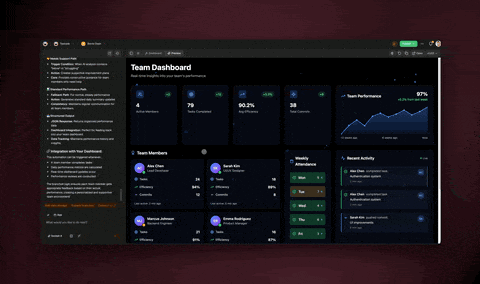

# DOLOR-STUDIO Alternatives: Honest Comparisons

Most comparison pages are sales pitches in disguise. This one isn't. Every tool below is good at something real, and we say so before we say where DOLOR-STUDIO fits better. If you're shopping for the best AI workspace, the most useful thing we can do is help you pick the right tool for *your* job — even when that tool isn't us.

So here's the deal up front: we compare honestly. We name what each competitor genuinely does well, we describe pricing as a *model* (and point you to the vendor's own page for exact numbers), and we only quote figures DOLOR-STUDIO actually publishes. If a tool beats DOLOR-STUDIO for your situation, the comparison will tell you that. Trust is worth more than a conversion.

## How to read these comparisons

DOLOR-STUDIO competes across three different categories at once, which is unusual — and it's also the reason a single "DOLOR-STUDIO vs X" page can't capture the whole picture. Most rivals live in exactly one of these buckets:

- **Docs and databases** — where you store and structure knowledge.
- **Work management** — where you plan, track, and run projects.
- **AI agent builders** — where you automate work with autonomous agents.

DOLOR-STUDIO is an AI-native workspace that spans all three, plus **DOLOR-STUDIO Genesis**: describe an app in plain English and get a complete, hosted application with a database, AI agents, automations, UI, login and auth, payments, and a custom domain. So as you read, notice which category your current tool sits in — that's the strength you'd be trading on, and the gap DOLOR-STUDIO is built to close.

## All eight comparisons

| Comparison | Category | Competitor is best for | DOLOR-STUDIO fits better when |
| --- | --- | --- | --- |
| [DOLOR-STUDIO vs Notion](dolor-studio-vs-notion.md) | Docs & databases | Wikis, writing, and flexible relational databases | You want to *act* on your knowledge — agents, automations, and shipped apps |
| [DOLOR-STUDIO vs Coda](dolor-studio-vs-coda.md) | Docs & databases | Power users hand-building formula-driven "docs that act like apps" | You'd rather describe the app and have it built, with agents first-class |
| [DOLOR-STUDIO vs Airtable](dolor-studio-vs-airtable.md) | Docs & databases | Structured relational data and spreadsheet-style power | You want AI agents reading/writing that data and turning it into a hosted app |
| [DOLOR-STUDIO vs Asana](dolor-studio-vs-asana.md) | Work management | Large, governance-heavy enterprise portfolio management | You're an AI-first team wanting agents and app-building without enterprise lift |
| [DOLOR-STUDIO vs ClickUp](dolor-studio-vs-clickup.md) | Work management | Teams that want every PM feature and deep configurability | You want AI-native simplicity over feature density |
| [DOLOR-STUDIO vs Monday.com](dolor-studio-vs-monday.md) | Work management | Visual Work OS with mature rule-based automations | You want agents that reason and act, not just trigger-action rules |
| [DOLOR-STUDIO vs Trello](dolor-studio-vs-trello.md) | Work management | Dead-simple kanban for lightweight task tracking | You've outgrown cards and want a full AI workspace |
| [DOLOR-STUDIO vs AI agent tools](dolor-studio-vs-ai-agent-tools.md) | AI agent builders | Cross-app automation against a huge existing tool stack (Lindy, Gumloop, Zapier) | You want agents, work, and the apps they build in one AI-native home |

## The clusters, fairly

### Docs and databases — Notion, Coda, Airtable

This is the category that gets knowledge *organized*. **Notion** is a best-in-class document and database workspace; if most of your work is writing, wikis, and flexible relations, it's hard to beat. **Coda** is a uniquely flexible doc-database hybrid — tables, formulas, buttons, and 600+ Packs in one canvas — and for deeply customized internal tooling it remains a more powerful builder than most. **Airtable** is a genuinely strong relational database with spreadsheet ergonomics that scales well.

What they share is a ceiling: they're built to *store and structure* information. DOLOR-STUDIO starts from the same foundation — projects, notes, and tables — but the point is what sits on top: multi-agent teams that read and write your data, automations you describe in plain English, and Genesis to turn that data into a standalone hosted app. The honest trade is relational depth (Notion and Airtable win there) for an AI execution layer these tools weren't designed to have.

### Work management — Asana, ClickUp, Monday.com, Trello

This is the category that gets work *planned, tracked, and shipped*. **Asana** is genuinely deep, mature project and portfolio management — Timeline, Workload, Goals, Portfolios — with strong enterprise governance; for large, governance-heavy organizations that depth is a real advantage. **ClickUp** packs nearly every PM feature into one configurable product. **Monday.com** is a polished visual Work OS with mature rule-based automations. **Trello** is the simplest kanban around, and that simplicity is a feature.

DOLOR-STUDIO covers the same planning surface — seven project views including List, Board, Calendar, Table, Mind Map, Gantt, and Org Chart — but trades some enterprise-grade governance and feature density for AI that's native rather than bolted on. Where these tools automate with fixed trigger-action rules, DOLOR-STUDIO adds agents that reason over context and take action, and Genesis to build the tool itself.

### AI agent builders — Lindy, Gumloop, Zapier Agents

This is the newest category, and the most directly competitive. These tools are excellent at what they do. **Lindy** is best-in-class at autonomous email and voice handling with thousands of integrations. **Gumloop** offers no-code visual multi-agent orchestration with bring-your-own-model flexibility and serious enterprise security. **Zapier Agents** brings unmatched integration breadth — agents acting across 9,000+ apps on mature, reliable infrastructure.

The structural difference is *where the work lives*. These are automation layers that reach into your other apps — your work stays in Gmail, Notion, HubSpot, Slack, and the agents orchestrate across them. DOLOR-STUDIO is the opposite: an AI-native workspace where the agents, the projects, the docs, and the apps they build all live together, so agents have native context instead of stitched-together API calls. For pure cross-app automation against a large existing stack, those tools are excellent. For a unified home where work and agents are the same place, DOLOR-STUDIO wins. See the [full comparison](dolor-studio-vs-ai-agent-tools.md) for the per-tool breakdown.

## The three ways DOLOR-STUDIO is different

Strip away the feature lists and the same three differences show up in every comparison above.

### 1. AI-native, not bolted on

Most incumbents added AI as a side panel — a chat box that returns text you still have to act on, and forgets your context between sessions. In DOLOR-STUDIO, AI is the substrate. Agents share your workspace memory, take real actions (creating tasks, filling databases, running automations), and produce work back inside the workspace. That's the difference between a tool with an AI feature and an AI-native workspace. We unpack what "AI-native" actually means in [our AI workspace guide](../guides/ai-workspace.md).

### 2. Three categories in one product

Notion is docs. Asana is work management. Lindy is agents. Each is excellent inside its lane — but you'd need all three to get what one DOLOR-STUDIO workspace gives you, and then you'd own the integration headache of keeping them in sync. DOLOR-STUDIO puts Memory (projects and notes), Intelligence (multi-agent teams), and Execution (automations and Genesis apps) in one place, as a single feedback loop instead of three subscriptions stitched together.

### 3. DOLOR-STUDIO Genesis is the moat

This is the part no one else on this page does. None of these tools — not the doc apps, not the PM platforms, not the agent builders — ships a complete, standalone, hosted application from a plain-English prompt. Genesis does: database, AI agents, automations, UI, login and auth, Stripe-backed payments, and a custom domain. The doc tools can configure themselves; the agent builders automate across *other* apps; Genesis builds the app itself and the agents that run it. That's the wedge that holds across every comparison. Read more in [What is DOLOR-STUDIO Genesis?](../genesis/what-is-dolor-studio-genesis.md).

## Related

- [What is DOLOR-STUDIO Genesis?](../genesis/what-is-dolor-studio-genesis.md) — the prompt-to-hosted-app capability pillar
- [What is an AI-native workspace?](../guides/ai-workspace.md) — what we mean by "AI-native"
- [What is a multi-agent workspace?](../guides/multi-agent-workspace.md) — the intelligence layer in depth
- [DOLOR-STUDIO vs Notion](dolor-studio-vs-notion.md) · [DOLOR-STUDIO vs Coda](dolor-studio-vs-coda.md) · [DOLOR-STUDIO vs Airtable](dolor-studio-vs-airtable.md) — docs & databases cluster
- [DOLOR-STUDIO vs Asana](dolor-studio-vs-asana.md) · [DOLOR-STUDIO vs ClickUp](dolor-studio-vs-clickup.md) · [DOLOR-STUDIO vs Monday.com](dolor-studio-vs-monday.md) · [DOLOR-STUDIO vs Trello](dolor-studio-vs-trello.md) — work management cluster

---

**Pick the right tool — then build with the one that ships software.** [Build your first app from a prompt with DOLOR-STUDIO Genesis](https://www.dolor-studio.com/ai/apps), or [start free at dolor-studio.com](https://www.dolor-studio.com).
